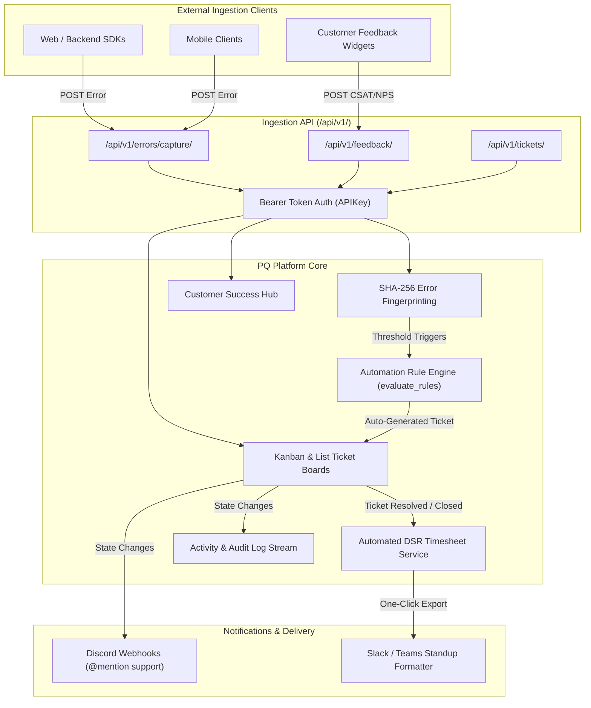

<div align="center">

# ⚡ PQ Platform (Product Quality & Reliability)

### *The Unified Developer Workspace for Error Tracking, Issue Management, Automated DSR Timesheets & Customer Operations.*

[](https://www.djangoproject.com/)
[](https://www.python.org/)
[](https://htmx.org/)
[](https://alpinejs.dev/)
[](https://www.django-rest-framework.org/)
[](https://www.docker.com/)
[](LICENSE)

<br />

**PQ Platform** bridges the chasm between production telemetry, sprint execution, customer feedback, and engineering accountability. Instead of paying for and juggling five disconnected SaaS tools (Sentry, Linear, Toggl, Zendesk, and Zapier), PQ Platform consolidates the entire developer feedback loop into a single, cohesive, blazing-fast workspace.

[Key Features](#-key-features) • [System Architecture](#-system-architecture) • [Quickstart Guide](#-quickstart-guide) • [Run it](docs/running-the-project.md) • [Docs](#-documentation) • [Demo Personas](#-demo-accounts--personas) • [API Reference](#-ingestion-api-reference) • [Design Philosophy](#-tech-stack--design-philosophy)

</div>

---

## 🌟 Why PQ Platform?

Engineering organizations frequently suffer from **context fragmentation**:
1. **Telemetry is trapped in silos:** Application errors trigger alerts in error monitoring tools that never get triaged into engineering sprint boards.
2. **Timesheets and DSRs are despised:** Engineers waste Friday afternoons manually guessing how many hours they spent on bug fixes, leading to inaccurate Daily Status Reports.
3. **Customer feedback gets lost:** Support tickets in CS tools don't link back to specific products or underlying error occurrences.
4. **Slow, inconsistent interfaces:** Five tools means five different designs. PQ Platform is one app with one component set, a dark theme, and keyboard shortcuts everywhere.

**PQ Platform solves this with one integrated workspace:**
- 💥 **Automated Incident-to-Ticket Flow:** Errors captured via SDK deduplicate into Error Groups. When error frequency exceeds threshold rules, the platform automatically files prioritized engineering tickets.
- ⏱️ **Zero-Friction DSR Timesheets:** When an engineer resolves a ticket, the platform automatically logs the elapsed duration into their Daily Status Report (DSR) spreadsheet.
- 💬 **Customer Success Operations:** Triage CSAT/NPS survey responses and bug reports directly into backlog items.
- 🧑‍💼 **People Operations:** Attendance with lateness rules, leave with paid/unpaid splitting and approvals, and payroll cycles that turn both into payslips.
- ⚡ **Plain server-rendered Django, with a polished interface:** **Django 6** renders every page; **HTMX** and **Alpine.js** make it feel instant; hand-written CSS gives one consistent look with a light and a dark theme. No JavaScript build step.

---

## 🏗️ System Architecture



---

## ✨ Key Features

### 1. 🎯 Linear-Style Ticket Tracking & Kanban
- **Flexible Views:** Seamless toggle between interactive **Kanban Board** and high-density **List View** with preserved search and filter parameters.
- **Instant Filtering:** Filter by status, priority, assignee, type, and search keyword; the filters live in the URL so a view can be shared.
- **Drag or Keyboard:** Drag cards between columns, move them with Alt + arrow keys, or use the Move menu on touch screens.
- **Full Lifecycle Support:** Manage tickets from `Backlog` ➔ `Todo` ➔ `In Progress` ➔ `In Review` ➔ `Resolved` ➔ `Closed`.

### 2. ⚡ Telemetry & Error Tracking (Sentry-Alternative)
- **High-Throughput Ingestion:** DRF-powered `/api/v1/errors/capture/` endpoint designed for SDKs.
- **SHA-256 Fingerprinting:** Intelligent clustering of exceptions into distinct `ErrorGroup` records with occurrence counts and timestamps.
- **1-Click Ticket Escalation:** Convert any production error directly into an assigned engineering ticket with attached stack traces.
- **Triage Actions:** Resolve or ignore errors directly from the dashboard or error detail views.

### 3. 📊 Automated DSR (Daily Status Report) & Timesheets
- **A table of everything submitted:** Today and history in one grid grouped by day (date, task, project, category, time, status), with range and person filters, search, edit and delete in place, and an **Export CSV** button.
- **Automatic Duration Tracking:** Resolving or closing a ticket logs an `Auto` DSR entry for assignees showing when the ticket was created and completed, with hours capped at one working day. `manage.py fix_dsr_hours` repairs older rows.
- **One-click catch-up:** A banner lists tickets you worked on today that are not in your DSR and adds them all at suggested hours.
- **Daily Target Progress:** Dynamic visual progress meter tracking completion toward the standard 8.0-hour daily goal.
- **Manager & Admin Oversight:** Company leadership can view team-wide progress bars, completed task metrics, and inspect individual timesheets.
- **Standup Formatter:** 1-click clipboard button that formats today's logged work into a clean Slack/Teams standup message.

### 4. 💬 CS Hub & Customer Feedback Ingestion
- **CSAT & NPS Collection:** Collect ratings, sentiment, and user comments via API or embeddable survey widgets.
- **Triage to Backlog:** Escalate customer feature requests and reported bugs directly to engineering teams.
- **Product-Scoped Analytics:** Track satisfaction scores across individual product releases.

### 5. 🤖 Auto-Ticket Automation Engine
- **Configurable Rule Engine:** Create custom `AutoTicketRule` triggers (e.g. *If error occurrences exceed 10 hits within 15 minutes, automatically file a Critical Bug*).
- **Background Cron Evaluation:** Run via `python manage.py evaluate_rules [--dry-run]` to continuously safeguard reliability.
- **Deduplication Safeguards:** Tracks execution logs to prevent spamming duplicate tickets for the same error surge.

### 6. 🔔 Discord Webhooks & Team Notifications
- **Real-Time Webhook Dispatch:** Post rich embeds to product-specific Discord channels on ticket creation, status changes, and critical incidents.
- **Native User Mentions:** Maps user profiles to Discord IDs (`<@discord_id>`) for direct attention and notification routing.

### 7. 🕒 Attendance, Leave & Payroll
- **Attendance:** One-click check-in and check-out (asking first, with your time worked), a live day counter, lateness bands that feed pay, a month sheet, a team view, correction requests that owners and admins approve, and reminders to check in and out.
- **Leave:** Leave types with yearly allowances and per-spell caps, a live paid/unpaid preview when you apply, a team calendar, and an approvals queue where approvers can adjust dates and the split.
- **Payroll:** Monthly salaries divided over each 27th–26th cycle's working days, cycle preview, locked runs, payslips that show how every figure was worked out, and company holidays.

### 8. 🔎 Search, Notifications & Presence
- **Ctrl K search** across tickets, errors, products and pages, limited to what you can open.
- **Notifications** in the app (grouped by day, filterable) and as web push, with a switch per kind in your profile. **Who is online** in the top bar.
- **Keyboard shortcuts:** `g` then a letter jumps between pages, `c` makes a ticket, `t` flips the theme, `[` folds the sidebar, `?` lists them all. They use ⌘ on a Mac and Ctrl elsewhere.
- **What's new:** a searchable timeline of every release, each with its own name, fed by `CHANGELOG.md`.

### 9. 🙂 A Friendly Interface
- A greeting that changes with the time of day, an on-time streak, milestone messages, and small celebrations when you finish things.
- Light and dark themes with a smooth switch, animated sidebar, tooltips on icon buttons, and a toast for every action.
- A profile page for you and a page for each colleague, a command palette that can also run actions, and export to CSV.

### 10. 🛡️ Two-Tier Multi-Tenancy & Access Control
- **Layer 1 (Company Isolation):** Complete tenant partitioning via `Company` and `Membership` roles (`Owner`, `Admin`, `Developer`, `Support`, `Viewer`).
- **Layer 2 (Per-Product RBAC):** Fine-grained `ProductAccess` controls ensuring developers and support agents only see products and tickets they have been explicitly granted.

---

## 🚀 Quickstart Guide

### Prerequisites
- **Python 3.12+**
- **SQLite 3** (Default) or PostgreSQL
- Git

### Local Setup (Virtual Environment)

```bash
# 1. Clone the repository
git clone https://github.com/Everest1508/product-quality-platform.git
cd product-quality-platform

# 2. Create and activate a Python virtual environment
python3 -m venv venv
source venv/bin/activate  # On Windows use: venv\Scripts\activate

# 3. Install dependencies
pip install -r requirements.txt

# 4. Migrate, load the Acme Corp demo workspace and create a superuser
./bootstrap.sh

# 5. Start the development server
python manage.py runserver 8010
```

### Send errors from your own app

```bash
pip install pq-befu        # Python (import pq_sdk); npm install pq-befu for Node
```

Not `pq-sdk`. Step-by-step, framework by framework: [docs/guides/using-the-sdk.md](docs/guides/using-the-sdk.md), or the **API** page of any product.

Visit **[http://localhost:8010](http://localhost:8010)** and sign in as `owner` / `testpass123`.

Edit a template or `templates/core/css/*.css` and refresh the browser: there is nothing to build.
**The full guide, with settings, scheduled jobs, Docker, deploying and troubleshooting, is in
[docs/running-the-project.md](docs/running-the-project.md).**

---

## 🐳 Docker Setup

Run the entire application in a container with persistent SQLite storage:

```bash
# Build and run with Docker Compose
docker-compose up --build
```

The application will be accessible at **[http://localhost:8011](http://localhost:8011)**.

---

## 👥 Demo Accounts & Personas

The `seed_data` management command wipes and initializes a complete demo workspace (**Acme Corp**) with 3 active products (*Checkout API*, *Mobile App*, *Billing Portal*), error logs, tickets, surveys, and timesheets.

All demo accounts share the password: `testpass123`

| Username | Role | Permissions & Recommended Testing Flow |
| :--- | :--- | :--- |
| **`owner`** | **Owner** | Full workspace access. Can invite members, view company-wide audit logs, manage company settings, and oversee all DSR timesheets. |
| **`admin`** | **Admin** | Manages products, automations, API keys, team memberships, and team DSR summaries. |
| **`dev1`** | **Developer** | Assigned to Checkout API and Mobile App. Tests Kanban boards, moves tickets to Resolved (triggers auto-DSR), and edits DSR sheets. |
| **`dev2`** | **Developer** | Assigned to Mobile App and Billing Portal. Test product isolation boundaries. |
| **`support`**| **Support** | Triages CS Hub feedback, converts customer complaints into tickets, tests support workflows. |
| **`viewer`** | **Viewer** | Read-only stakeholder view for executives and external auditors. |

---

## 🔌 Ingestion API Reference

External services, backend workers, and client applications authenticate using product-scoped API keys passed in the `Authorization` header:

```http
Authorization: Bearer <YOUR_PRODUCT_API_KEY>
```

### 1. Ingest Error Occurrence
Capture unhandled exceptions and runtime errors from your backend or frontend apps.

```bash
curl -X POST http://localhost:8010/api/v1/errors/capture/ \
  -H "Authorization: Bearer <API_KEY>" \
  -H "Content-Type: application/json" \
  -d '{
    "message": "PaymentIntent requires_payment_method: Customer card was declined",
    "error_type": "StripePaymentError",
    "severity": "critical",
    "stack_trace": "File \"/app/services/billing.py\", line 142, in process_charge\n  raise StripePaymentError(\"Card declined\")",
    "culprit": "services/billing.py:142",
    "environment": "production",
    "release": "1.4.0",
    "metadata": {
      "user_id": "usr_9912",
      "cart_total": 84.50
    }
  }'
```

### 2. Submit Customer Feedback / Survey
Ingest CSAT ratings, NPS responses, or bug reports directly into the CS Hub.

```bash
curl -X POST http://localhost:8010/api/v1/feedback/ \
  -H "Authorization: Bearer <API_KEY>" \
  -H "Content-Type: application/json" \
  -d '{
    "customer_email": "jane.doe@example.com",
    "rating": 2,
    "category": "bug",
    "comment": "The checkout page gave me an error after entering my billing address."
  }'
```

### 3. Create a Ticket Programmatically
Create a tracked engineering issue from third-party systems (e.g. CI/CD pipelines, monitoring alerts).

```bash
curl -X POST http://localhost:8010/api/v1/tickets/ \
  -H "Authorization: Bearer <API_KEY>" \
  -H "Content-Type: application/json" \
  -d '{
    "title": "Database connection pool exhausted during nightly sync",
    "ticket_type": "bug",
    "priority": "high",
    "description": "Connection pool reached maximum threshold of 50 connections."
  }'
```

### 4. Update Ticket Status
Update progress or close out tickets from automated deployment pipelines.

```bash
curl -X PATCH http://localhost:8010/api/v1/tickets/42/status/ \
  -H "Authorization: Bearer <API_KEY>" \
  -H "Content-Type: application/json" \
  -d '{
    "status": "resolved"
  }'
```

---

## ⚙️ Management Commands

### `evaluate_rules`
Evaluates configured threshold rules against recent `ErrorGroup` frequency to automatically file tickets. Designed to be run periodically via cron (e.g. every 5 minutes):

```bash
# Execute evaluation and create tickets
python manage.py evaluate_rules

# Dry-run mode: prints evaluations without modifying data
python manage.py evaluate_rules --dry-run
```

### `send_attendance_reminders`
Reminds people to check in (a few minutes after their shift starts) and to check out (after it ends). Only people who punched in the last 30 days are nudged, never on weekends, holidays or approved leave, and each person gets each reminder at most once a day. People can switch either kind off under Profile → Notifications. Run it from cron every 5 to 10 minutes:

```bash
python manage.py send_attendance_reminders [--dry-run]
```

### `notify_todos`, `fix_dsr_hours`
`notify_todos` sends one reminder a day about overdue to-dos (run it every morning). `fix_dsr_hours [--dry-run]` caps old auto-logged DSR rows that show more than one working day of hours.

### `seed_data`
Resets the database and populates high-fidelity sample data across all entities:

```bash
python manage.py seed_data
```

---

## 🎨 Tech Stack & Design Philosophy

| Layer | Technology | Rationale |
| :--- | :--- | :--- |
| **Backend Framework** | **Django 6.0** | Robust ORM, built-in security protections, enterprise authentication, and bulletproof relational data modeling. |
| **Pages** | **Django templates + HTMX + Alpine.js** | Every page is rendered by Django. HTMX swaps parts of a page without a reload, and Alpine.js handles small things like menus and tabs. |
| **Look** | **Hand-written CSS** | A token file (`templates/core/css/_tokens.css`) holds the colours for light and dark themes; every stylesheet reads those tokens. No build tool. |
| **Live features** | **Django Channels** | WebSockets for presence, notifications and the Serop inbox. |
| **API Layer** | **Django REST Framework** | Token-authenticated ingestion endpoints with throttling, validation, and JSON schemas. |
| **Database** | **SQLite / PostgreSQL** | Zero-config SQLite out of the box with total migration compatibility for production PostgreSQL. |

> ### 💡 No front-end build
> The interface is server-rendered on purpose: one codebase, nothing to compile, and a deploy is a Python rebuild. The CSS lives in a few files under `templates/core/css/` and reads colour tokens, which is what makes the dark theme work on every page at once.

---

## 📁 Repository Structure

```text
product-quality-platform/
├── apps/
│   ├── accounts/       # User model, multi-tenant Company, Membership, & Auth views
│   ├── automation/     # Auto-ticket threshold rules & cron evaluation engine
│   ├── attendance/     # Check-in/out, lateness, corrections, team and timesheet views
│   ├── leave/          # Leave types, paid/unpaid split, calendar, approvals
│   ├── payroll/        # Pay cycles, runs, payslips, salaries, holidays
│   ├── notifications/  # In-app and web-push notifications
│   ├── presence/       # Who is online (WebSocket)
│   ├── core/           # Middleware, tenant-scoped base models, search, PWA
│   ├── dashboards/     # Executive stats, needs-attention list, activity audit log
│   ├── dsr/            # Daily Status Report spreadsheet, auto-logger, & standup export
│   ├── errors/         # Error groups, occurrences, stack traces, & triage views
│   ├── feedback/       # Customer Success Hub, CSAT / NPS surveys, & feedback ingestion
│   ├── ingestion/      # Public API (/api/v1/) with per-product APIKey authentication
│   ├── products/       # Product management, versioning, Discord webhooks, & RBAC access
│   └── tickets/        # Kanban board, list view, ticket lifecycle, comments, & assignments
├── core/
│   ├── settings.py     # Global Django configuration & security parameters
│   ├── urls.py         # Root URL routing table
│   ├── asgi.py         # ASGI app: HTTP plus the WebSocket routes
│   └── wsgi.py         # WSGI entry point (no WebSockets)
├── docs/               # Running the project, the feature guide, user guides
├── templates/          # Every page, plus the shared CSS in templates/core/css/
├── bootstrap.sh        # Migrate, seed demo data, create a superuser
├── docker-compose.yml  # Local container orchestration
├── Dockerfile          # Multi-stage production container image
├── entrypoint.sh       # Container migration & startup script
└── requirements.txt    # Python package dependencies
```

---

## 🧪 Testing & Verification

Run the test suite using Django's test runner:

```bash
# Run tests across all platform applications
python manage.py test apps

# Run tests for a specific module (e.g. Tickets access control)
python manage.py test apps.tickets

# Run tests for ingestion API
python manage.py test apps.ingestion

```

One test (`test_signup_creates_user`) fails on a clean checkout because the self-serve signup route does not exist; it is not a regression.

---

## 📚 Documentation

| Where | What |
| :--- | :--- |
| [docs/running-the-project.md](docs/running-the-project.md) | Install, run, configure, schedule jobs, use Docker, deploy, troubleshoot. |
| [docs/feature-guide.md](docs/feature-guide.md) | What was added, when, why, and how to use it, with a release timeline. |
| [docs/guides/](docs/guides/README.md) | How-tos for the people using the app: attendance, DSR, tickets, home and reports, presence. |
| [CHANGELOG.md](CHANGELOG.md) | Every release, each with its own name. The same text feeds the in-app **What's new**. |
| [CLAUDE.md](CLAUDE.md) and [AGENTS.md](AGENTS.md) | How the code is organised and the rules each area follows, for anyone changing it. |

---

## 📄 License

This project is licensed under the **MIT License**. Feel free to use, modify, and distribute it in your own software.
