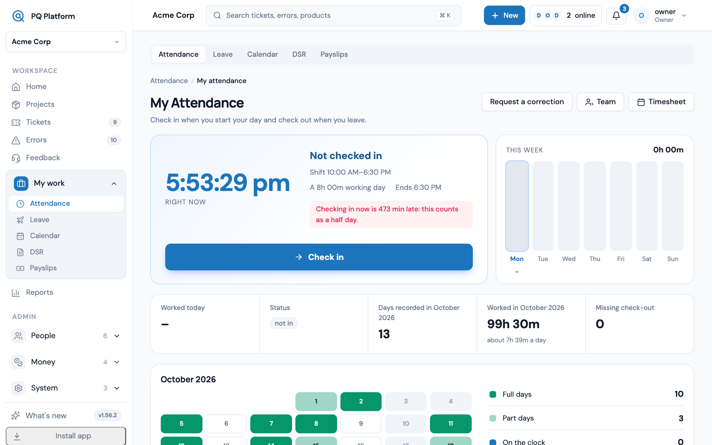
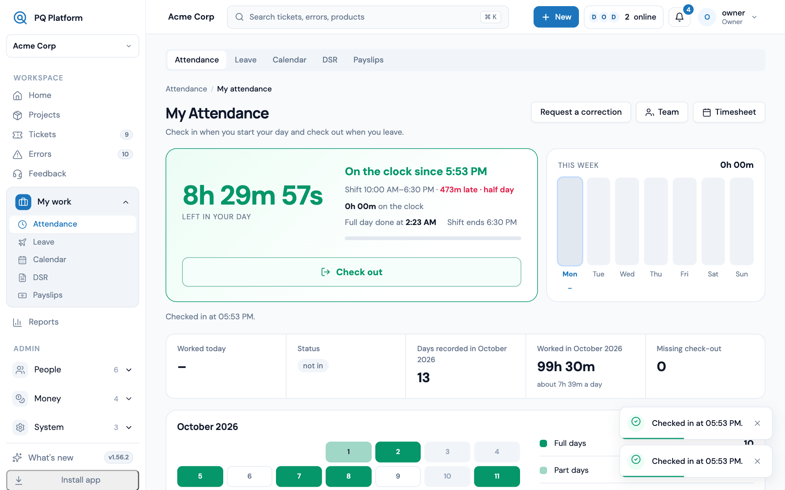
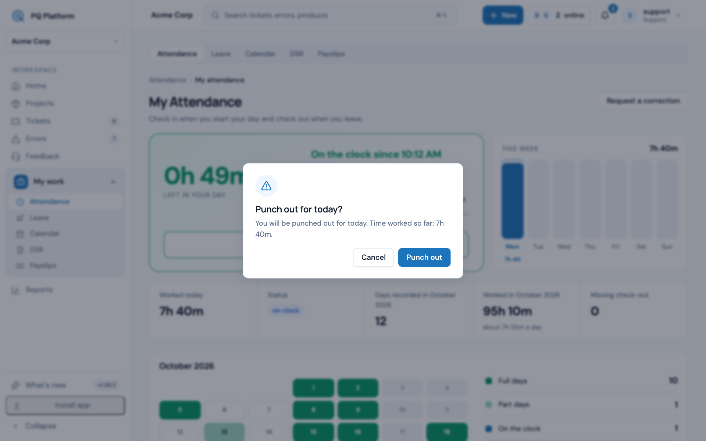
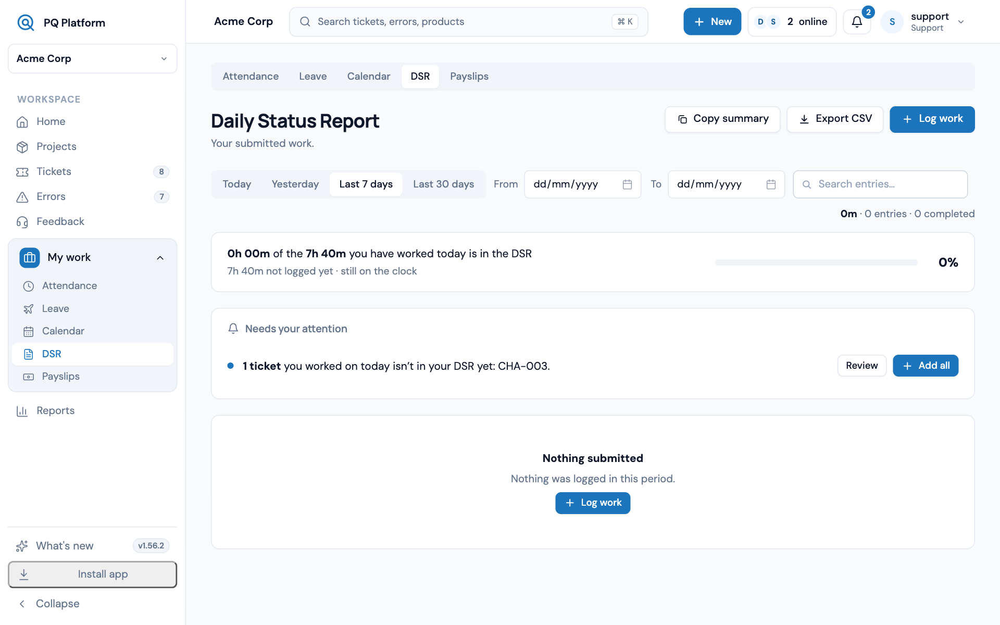
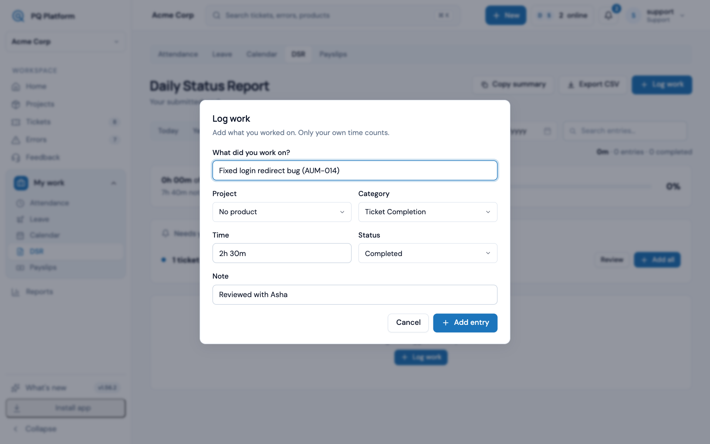
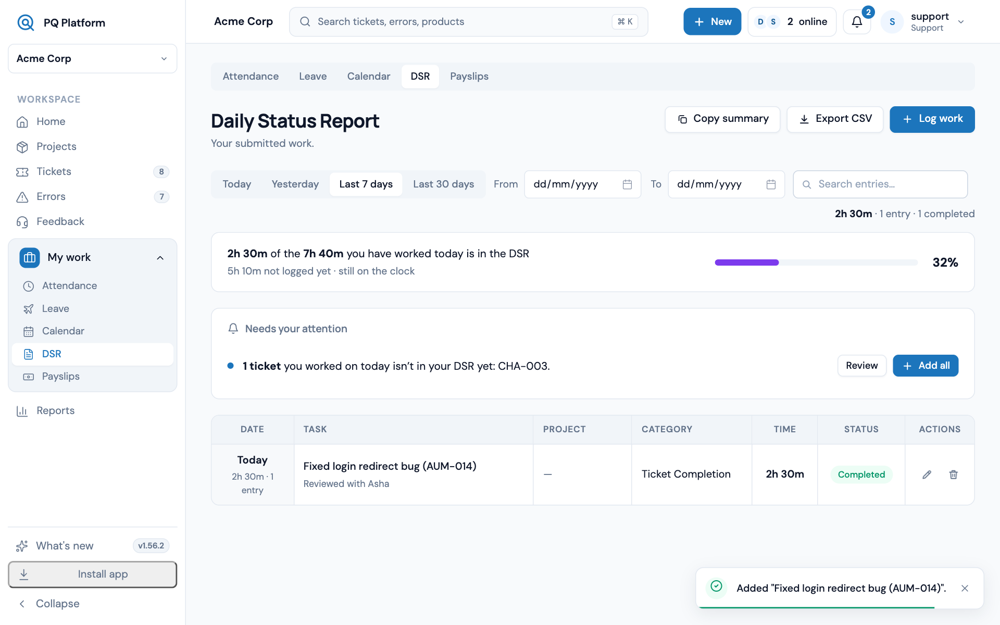

# How to punch attendance, create a DSR and submit it

Every working day has two records: your **attendance** (when you were on the clock) and your **DSR**, the Daily Status Report (what you did with that time). Both live under **My work** in the sidebar.

## 1. Open Attendance

Go to **My work → Attendance**. Before you have started, the big button says **Check in**.

## 2. Check in when you start

Press **Check in**. A message confirms the time, the card turns green, and the clock starts counting. If you arrive after the shift start, the card shows how late you are.

## 3. Check out when you finish

At the end of the day, press **Check out**, then confirm with **Punch out**. The dialog shows the time worked so far, so you can see it before you leave.

## 4. Open your DSR

Go to **My work → DSR**. The bar at the top compares the time in your DSR with the time you have worked today. If **Needs your attention** lists tickets you worked on, press **Review** to pick which to add, or **Add all** to add them at once.

## 5. Log what you worked on

Press **Log work**. Fill in:

- **What did you work on?** A short description. Include the ticket key, for example AUM-014.
- **Project** and **Category**.
- **Time**, for example `1h 30m`.
- **Status**, and an optional **Note**.

Press **Add entry**. Repeat for each piece of work.

## 6. Check it is submitted

There is no separate submit button. **Add entry** saves straight into your DSR, and a message confirms it. The entry appears in the table, and the bar at the top shows how much of your worked time is logged. When it reads **Everything is logged**, you are done.

## Tips

- Log as you go. You can only edit today's DSR. After midnight, only an owner or admin can change it.
- Press **Copy summary** to paste your day into a chat or email.
- Forgot to check out? Use **Request a correction** on the Attendance page.
